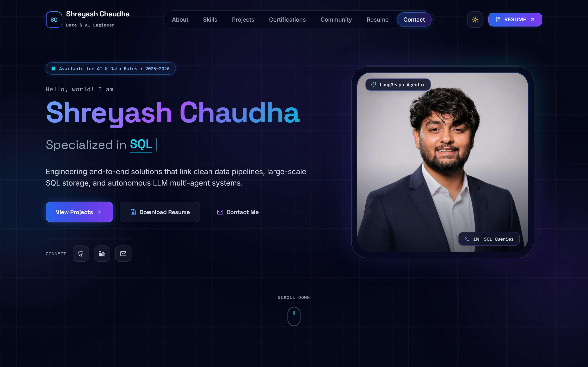
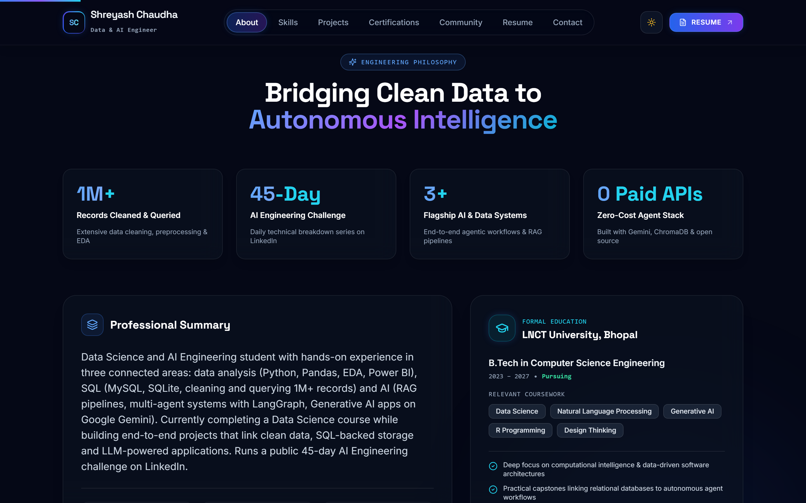
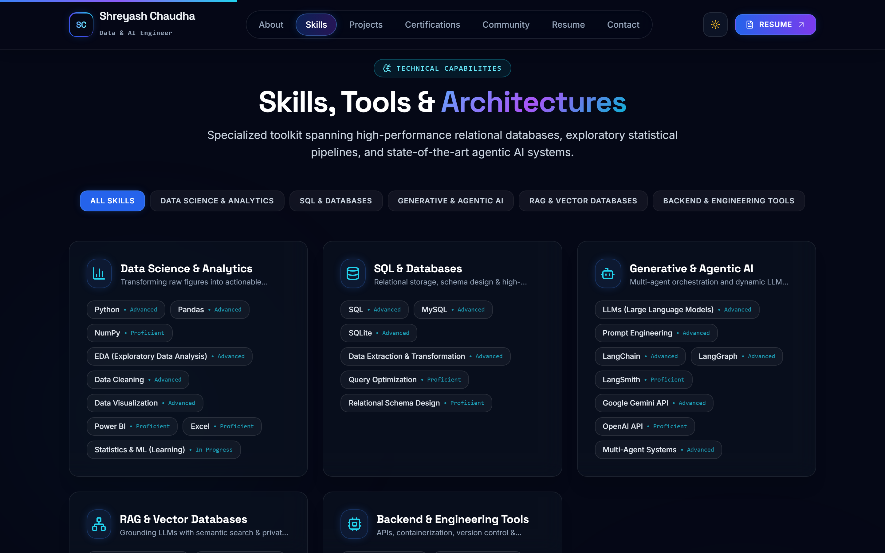
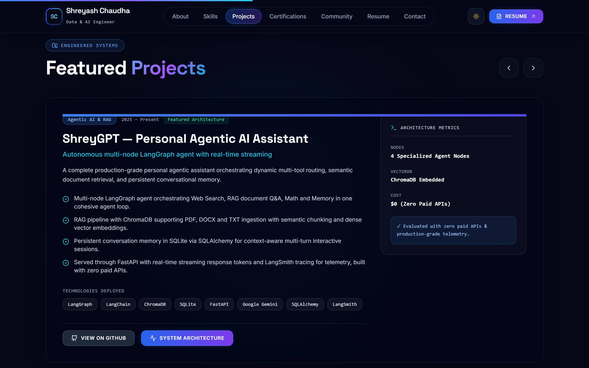
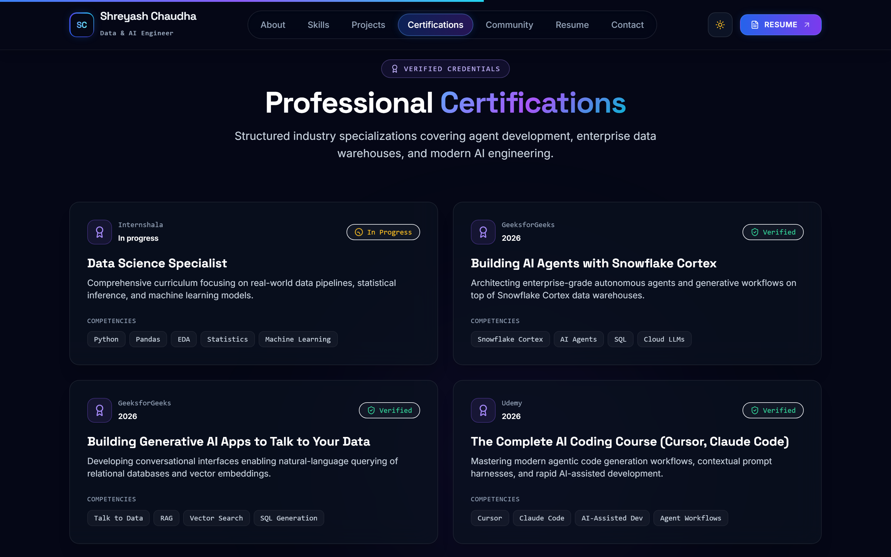
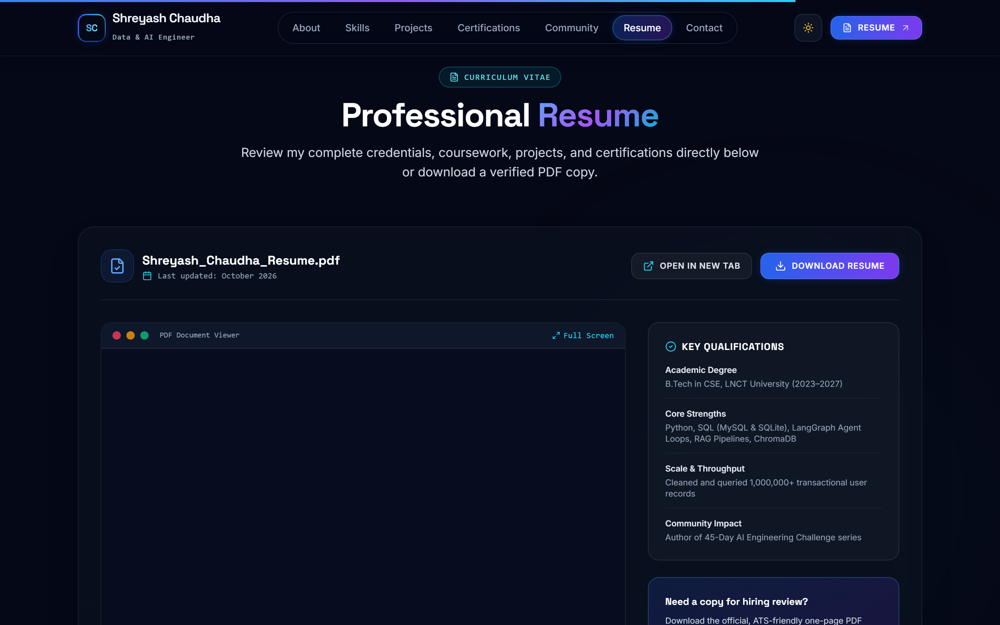
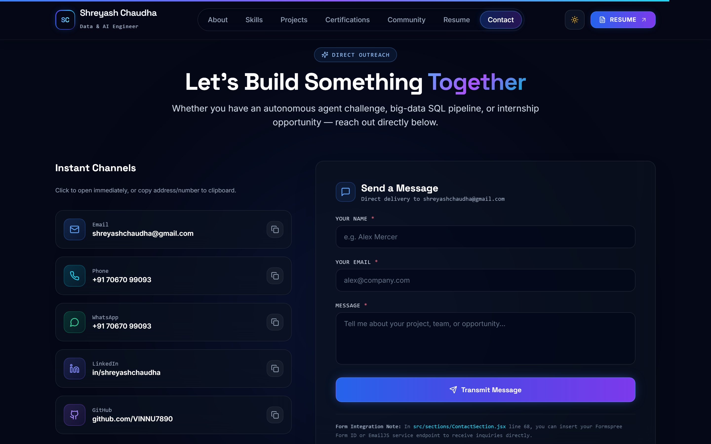
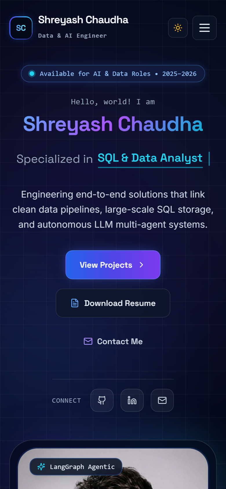
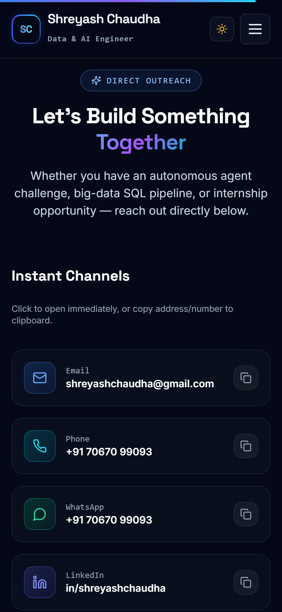
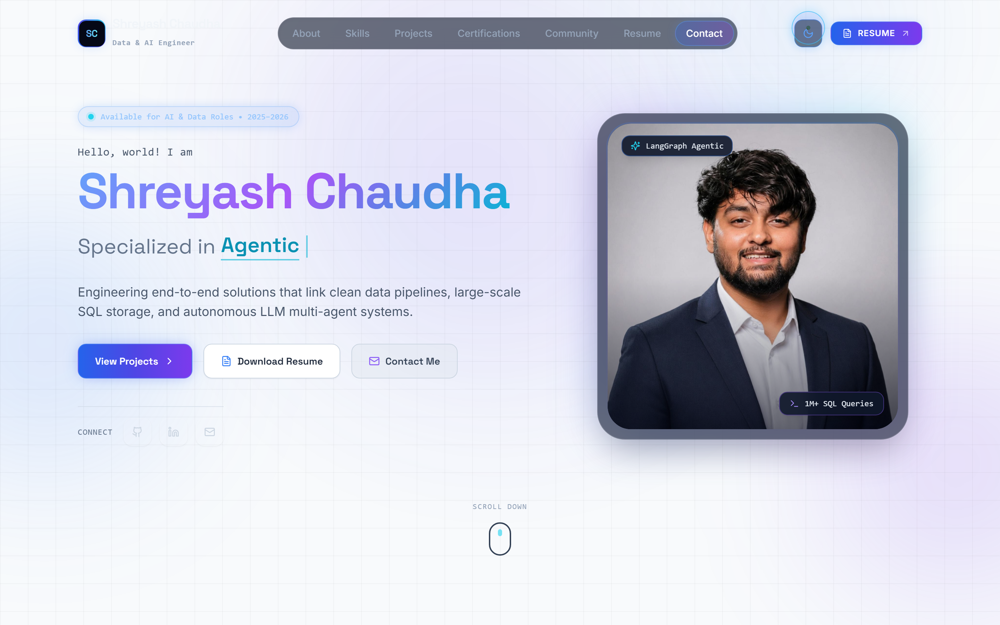

<div align="center">

# Shreyash Chaudha | Personal Portfolio

**Data Science | SQL Analytics | Generative & Agentic AI Engineer**

[](https://react.dev/)
[](https://vitejs.dev/)
[](https://tailwindcss.com/)
[](https://www.framer.com/motion/)
[](LICENSE)
[](https://vercel.com/)
[](https://www.netlify.com/)

<br />

<a href="#-live-demo">
  
</a>

### 🌐 Live Demo
> **[🔗 View Live Portfolio Demo](https://your-live-link.vercel.app)**  
> *(Note: Replace `https://your-live-link.vercel.app` with your production URL after deploying to Vercel/Netlify)*

</div>

---

## 📑 Table of Contents

- [About The Project](#-about-the-project)
- [Key Features](#-key-features)
- [Screenshots Gallery](#-screenshots-gallery)
  - [Desktop Showcase](#desktop-showcase)
  - [Mobile Responsive](#mobile-responsive)
  - [Light Theme](#light-theme)
- [Tech Stack](#-tech-stack)
- [Project Structure](#-project-structure)
- [Getting Started](#-getting-started)
  - [Prerequisites](#prerequisites)
  - [Installation & Local Run](#installation--local-run)
- [Customization Guide](#-customization-guide)
  - [1. Update Profile & Content](#1-update-profile--content)
  - [2. Swap Headshot & Resume PDF](#2-swap-headshot--resume-pdf)
  - [3. Configure Contact Form](#3-configure-contact-form)
- [Deployment](#-deployment)
  - [Deploy to Vercel](#deploy-to-vercel)
  - [Deploy to Netlify](#deploy-to-netlify)
- [Contact & Connect](#-contact--connect)
- [License](#-license)

---

## 💡 About The Project

This repository contains the production-grade, developer portfolio website for **Shreyash Chaudha** — a Data Science and AI Engineering student at LNCT University, Bhopal. It is engineered to highlight end-to-end expertise in exploratory data analysis (EDA), large-scale SQL pipelines querying 1M+ records, autonomous multi-agent systems built with LangGraph, and RAG retrieval architectures with zero paid APIs.

Designed from the ground up with a sleek, near-black navy theme (`#050816`), glassmorphic panels, and glowing cyan-to-violet accents that harmonize with Shreyash's professional blazer portrait.

---

## ✨ Key Features

- 🎯 **Custom Animated Cursor**: Dual-element physics with a precision center dot and a spring-delayed trailing outer ring. Seamlessly transitions into a glowing **"View"** label when hovering over projects, expands on clickable elements, and automatically deactivates on touch/mobile devices with respect for `prefers-reduced-motion`.
- 🧲 **Magnetic Buttons & Socials**: Interactive CTA buttons and social media icons smoothly pull towards the cursor on hover with realistic spring resistance.
- 🧊 **3D Tilt & Glare Reflections**: Parallax 3D tilt with cursor-following radial spotlight reflections across the profile portrait frame and project cards.
- 🌊 **Smooth Lenis Scrolling**: Kinetic, buttery-smooth page scrolling paired with a top-mounted reading progress bar.
- ⚡ **Interactive Skills Marquee**: Two-row infinite scrolling tech marquee moving in opposing directions with pause-on-hover physics, alongside categorized filter cards.
- 🎠 **Projects Carousel & Architecture Modal**: Horizontal sliding project showcase with arrows, progress dots, tech badges, GitHub links, and an in-depth System Architecture breakdown modal.
- 🌓 **Dark & Light Mode Toggle**: Dark theme by default, with smooth CSS variable transitions to a light theme.
- 📄 **Embedded PDF Resume Viewer**: Dedicated `#resume` section featuring an embedded document viewer, "Download Resume" direct action, and "Open in new tab" link.
- 📬 **Functional Contact Form & Copy-To-Clipboard**: Instant communication channels (Email, Phone, WhatsApp, LinkedIn, GitHub) with one-click copy-to-clipboard toast feedback, plus a validated contact form with loading states and celebration confetti.
- 📱 **100% Responsive Design**: Optimized across mobile (390px), tablet, and desktop (1440px+) displays with a slide-in mobile navigation drawer.
- 🚀 **SEO & Performance Ready**: Comprehensive Open Graph tags, Twitter cards, meta descriptions, and zero broken links.

---

## 📸 Screenshots Gallery

### Desktop Showcase

| Hero & Profile Introduction | About & Experience Pillars |
| :---: | :---: |
| <br />*Hero with dynamic typewriter roles and 3D tilt portrait* | <br />*Animated counters (1M+ records) & education card* |

| Technical Skills & Marquee | Featured Projects Carousel |
| :---: | :---: |
| <br />*Categorized competencies with two-row auto-scrolling marquee* | <br />*ShreyGPT, 1M+ Records EDA, and FRIDAY AI Assistant* |

| Verified Certifications | Embedded Resume Viewer |
| :---: | :---: |
| <br />*Internshala, GeeksforGeeks, and Udemy credentials* | <br />*Embedded PDF preview with instant download button* |

<div align="center">

### Direct Contact & Message Transmission
<br />
*Instant channels with copy-to-clipboard, WhatsApp link, and working form*

</div>

### Mobile Responsive

<div align="center">

| Mobile Home (390x844) | Mobile Contact (390x844) |
| :---: | :---: |
|  |  |
| *Mobile view with responsive nav and quick actions* | *Mobile contact channels with one-tap interaction* |

</div>

### Light Theme

<div align="center">

<br />
*Clean light theme mode with subtle grid pattern and high contrast*

</div>

---

## 💻 Tech Stack

| Category | Technologies |
| :--- | :--- |
| **Frontend Framework** | React 18.3, Vite 5.4, JavaScript (ES Modules) |
| **Styling & Design** | Tailwind CSS 3.4, PostCSS, Autoprefixer, Custom Glassmorphism |
| **Animations & FX** | Framer Motion 11.15, Lenis Smooth Scroll, Canvas Confetti |
| **Icons & Typography** | Lucide React, Google Fonts (*Space Grotesk*, *Sora*, *Inter*) |
| **Tooling & Automation** | Playwright (Automated screenshot capture), Node.js, npm |
| **Hosting & Deployment** | Vercel (`vercel.json`), Netlify (`public/_redirects`) |

---

## 📂 Project Structure

```
├── .env.example                         # Environment variables template
├── .gitignore                           # Excludes node_modules, dist, env, logs
├── LICENSE                              # MIT License
├── README.md                            # Comprehensive project documentation
├── index.html                           # HTML shell with SEO meta & Google Fonts
├── package.json                         # Dependencies & scripts
├── package-lock.json                    # Exact dependency lockfile
├── postcss.config.js                    # PostCSS plugins
├── tailwind.config.js                   # Extended theme, fonts, animations, glows
├── vercel.json                          # Single Page Application rewrites for Vercel
├── vite.config.js                       # Vite build configuration
├── public/
│   ├── _redirects                       # Netlify SPA routing fallback
│   ├── favicon.svg                      # Brand SVG gradient favicon
│   ├── assets/
│   │   └── shreyash.png                 # Optimized headshot portrait
│   └── resume/
│       └── Shreyash_Chaudha_Resume.pdf  # ATS-ready resume PDF
├── screenshots/                         # Captured high-res screenshots
│   ├── about.png
│   ├── certifications.png
│   ├── contact.png
│   ├── full-page.png
│   ├── hero.png
│   ├── light-mode.png
│   ├── mobile-contact.png
│   ├── mobile-home.png
│   ├── projects.png
│   ├── resume.png
│   └── skills.png
├── scripts/
│   └── screenshots.mjs                  # Playwright automated screenshot script
└── src/
    ├── App.jsx                          # Main application layout & section router
    ├── main.jsx                         # React DOM root entrypoint
    ├── components/
    │   ├── CustomCursor.jsx             # Dual spring trailing cursor with 'View' mode
    │   ├── MagneticButton.jsx           # Magnetic spring attraction component
    │   ├── Navbar.jsx                   # Sticky glass navbar with sliding pill
    │   ├── NotFound.jsx                 # 404 fallback view
    │   ├── ScrollProgressBar.jsx        # Top reading scroll progress bar
    │   ├── SpotlightGlow.jsx            # Ambient radial mouse glow
    │   ├── TiltCard.jsx                 # 3D parallax tilt card with glare spotlight
    │   └── Toast.jsx                    # Slide-in toast notification component
    ├── data/
    │   └── portfolioData.js             # Central data store (all info in one file)
    ├── hooks/
    │   ├── useLenis.js                  # Kinetic smooth scroll integration
    │   ├── useScramble.js               # Cyber text scramble decryption hook
    │   └── useTheme.js                  # Dark/light theme persistence hook
    ├── sections/
    │   ├── HeroSection.jsx              # Section 1: Hero with typewriter & photo arch
    │   ├── AboutSection.jsx             # Section 2: Summary, stats & education
    │   ├── SkillsSection.jsx            # Section 3: Grouped cards & marquee
    │   ├── ProjectsSection.jsx          # Section 4: Projects carousel & architecture modal
    │   ├── CertificationsSection.jsx    # Section 5: Verified credentials
    │   ├── CommunitySection.jsx         # Section 6: 45-day LinkedIn challenge
    │   ├── ResumeSection.jsx            # Section 7: Embedded PDF viewer & download
    │   ├── ContactSection.jsx           # Section 8: Direct channels & form
    │   └── Footer.jsx                   # Section 9: Quick links & back to top
    └── styles/
        └── index.css                    # Tailwind directives, glassmorphic utilities
```

---

## 🚀 Getting Started

### Prerequisites
- **Node.js**: Version 18.0.0 or higher
- **npm**: Version 9.0.0 or higher

### Installation & Local Run

1. **Clone the repository**:
   ```bash
   git clone https://github.com/VINNU7890/Personal-portfolio-website-.git
   cd Personal-portfolio-website-
   ```

2. **Install project dependencies**:
   ```bash
   npm install
   ```

3. **Start the local development server**:
   ```bash
   npm run dev
   ```
   Open `http://localhost:3000` in your web browser.

4. **Create a production build**:
   ```bash
   npm run build
   ```

5. **Preview the production build locally**:
   ```bash
   npm run preview
   ```

---

## 🎨 Customization Guide

### 1. Update Profile & Content
All personal bio information, stats, project descriptions, skills, and social URLs are centralized in a single file:
👉 [`src/data/portfolioData.js`](src/data/portfolioData.js)

Simply edit the exports in this file to update the entire site without touching layout code:
- `personalInfo`: Name, titles, typewriter roles, emails, phone, social handles.
- `metrics`: Numeric counters for records cleaned, challenges, and projects.
- `education`: University, degree, coursework, and dates.
- `skillCategories`: Categorized skill chips with proficiency levels.
- `projects`: Project highlights, tech stack chips, bullets, and GitHub links.
- `certifications`: Title, issuing organization, year, and verification status.
- `communityContent`: 45-day challenge description and topics.

### 2. Swap Headshot & Resume PDF
- **Profile Photo**: Replace `public/assets/shreyash.png` with your new image.
- **Resume PDF**: Replace `public/resume/Shreyash_Chaudha_Resume.pdf` with your updated resume.

### 3. Configure Contact Form
Copy `.env.example` to `.env`:
```bash
cp .env.example .env
```
Fill in your Formspree ID or EmailJS keys:
```env
# Formspree Option (Recommended)
VITE_FORMSPREE_ID=your_formspree_id_here

# EmailJS Option (Alternative)
VITE_EMAILJS_SERVICE_ID=your_service_id_here
VITE_EMAILJS_TEMPLATE_ID=your_template_id_here
VITE_EMAILJS_PUBLIC_KEY=your_public_key_here
```
*(If no environment variables are set, the contact form operates in an interactive simulation mode with confirmation toast and confetti).*

---

## 🌐 Deployment

### Deploy to Vercel

1. Push your repository to GitHub.
2. Sign in to [vercel.com](https://vercel.com) and click **"Add New Project"**.
3. Import `VINNU7890/Personal-portfolio-website-`.
4. Vercel automatically detects the Vite framework settings:
   - **Build Command**: `npm run build`
   - **Output Directory**: `dist`
5. Click **Deploy**. The included [`vercel.json`](vercel.json) manages all Single Page Application client-side routing.

### Deploy to Netlify

1. Sign in to [netlify.com](https://www.netlify.com/) and click **"Add new site"** > **"Import an existing project"**.
2. Select your GitHub repository.
3. Build configuration:
   - **Build command**: `npm run build`
   - **Publish directory**: `dist`
4. Click **Deploy Site**. The included [`public/_redirects`](public/_redirects) guarantees clean routing.

---

## 📬 Contact & Connect

**Shreyash Chaudha**  
*Data Science | SQL | Generative & Agentic AI*

- 📧 **Email**: [shreyashchaudha@gmail.com](mailto:shreyashchaudha@gmail.com)
- 📱 **Phone**: [+91 70670 99093](tel:+917067099093)
- 💬 **WhatsApp**: [Chat on WhatsApp](https://wa.me/917067099093)
- 💼 **LinkedIn**: [linkedin.com/in/shreyashchaudha](https://linkedin.com/in/shreyashchaudha)
- 🐙 **GitHub**: [github.com/VINNU7890](https://github.com/VINNU7890)

---

## 📄 License

This project is licensed under the MIT License — see the [LICENSE](LICENSE) file for details.

<div align="center">
  <sub>Made with ❤️ by <b>Shreyash Chaudha</b> • Star this repo if you find it helpful! ⭐</sub>
</div>
